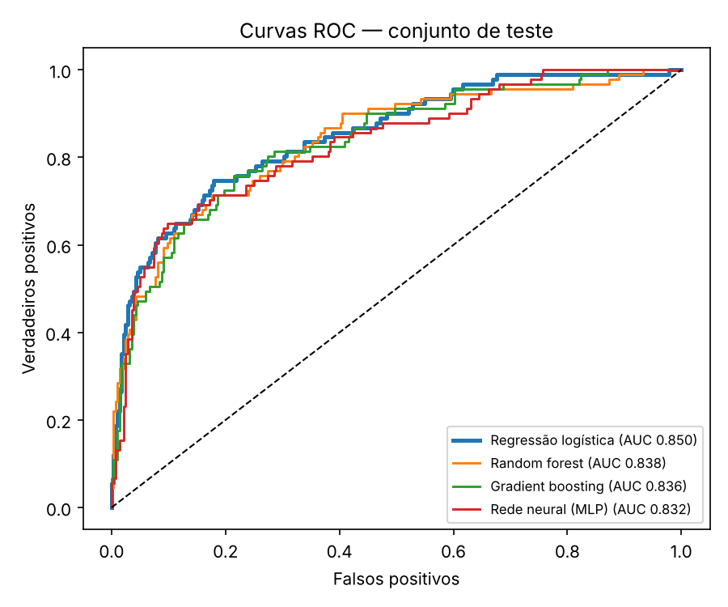
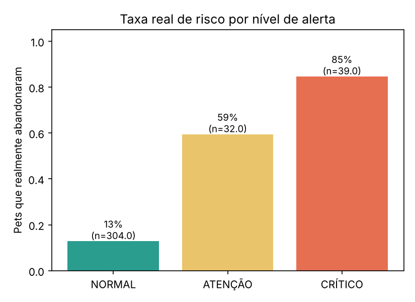
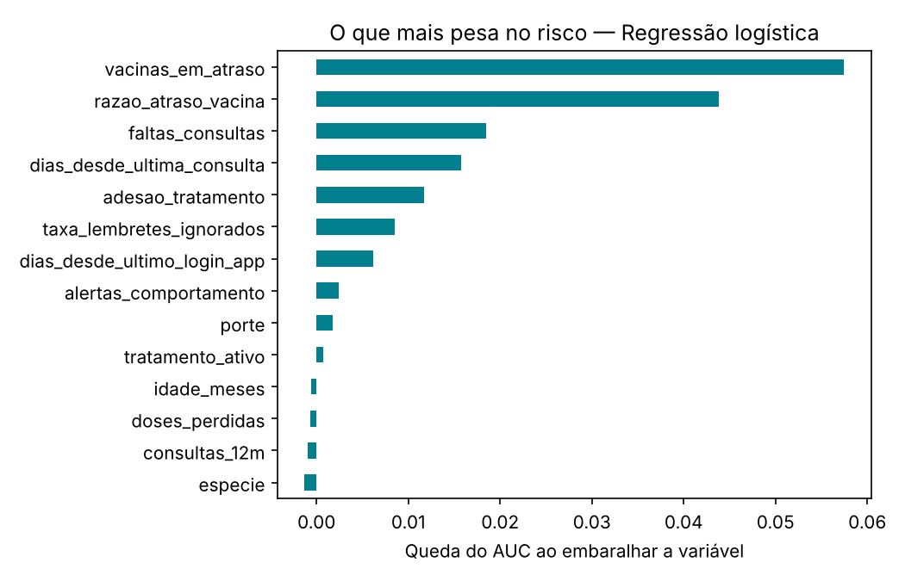

# VetFlow IA: previsão de abandono de cuidados

Serviço de inteligência artificial do **VetFlow**, o sistema de gestão veterinária em parceria com a **CLYVO VET**. Para cada pet, ele responde três perguntas:

1. **Qual o risco** de o tutor abandonar vacinas, retornos ou tratamento nos próximos 30 dias?
2. **Por quê?** Os motivos vêm com os dados reais do pet.
3. **O que fazer agora?** Uma ação recomendada, personalizada.

O risco é calculado por um **modelo estatístico determinístico**. A IA generativa (LLM, no n8n) apenas redige mensagens ao tutor: ela nunca calcula o risco nem decide o nível de alerta.

> ⚠️ **Sobre os dados.** O modelo foi treinado com um **dataset sintético**. Os resultados abaixo validam a **arquitetura e o pipeline de ponta a ponta**, não o desempenho em clínicas reais.

## Sumário
- [Equipe](#equipe)
- [Visão geral](#visão-geral)
- [Arquitetura](#arquitetura)
- [Estrutura do repositório](#estrutura-do-repositório)
- [Tecnologias](#tecnologias)
- [Como usar](#como-usar)
- [API](#api)
- [Preparação e validação dos dados](#preparação-e-validação-dos-dados)
- [Modelo e resultados](#modelo-e-resultados)
- [Personalização](#personalização)
- [Acompanhamento contínuo (n8n)](#acompanhamento-contínuo-n8n)
- [Servidor MCP](#servidor-mcp)
- [Integração com o VetFlow](#integração-com-o-vetflow)
- [Testes](#testes)
- [Segurança](#segurança)
- [Limitações](#limitações)

## Equipe
| Nome | RM | Turma |
|---|---|---|
| Andrei de Paiva Gibbini | 563061 | 2TDSPF |
| Pedro Sakai Silva Zambaca | 565956 | 2TDSPF |
| Pedro Santos Pequini | 561842 | 2TDSPF |
| Arthur Câmara | 562310 | 2TDSPG |
| Diogo Cunha | 563654 | 2TDSPF |

## Visão geral
Muitos tutores só procuram a clínica quando o pet já está mal. O resultado é baixa recorrência, histórico fragmentado e vacinas e tratamentos abandonados sem que ninguém perceba. A VetFlow IA identifica esses pets antes, e o fluxo de acompanhamento avisa o tutor e a clínica.

Cada previsão devolve:
- **score**: probabilidade de abandono em 30 dias (0 a 1);
- **nível de alerta**: `NORMAL` (< 0,40), `ATENÇÃO` (0,40 a 0,70) ou `CRÍTICO` (≥ 0,70);
- **fatores**: até 3 grupos que mais pesam no risco daquele pet, com o motivo em linguagem natural;
- **ação recomendada**, escolhida pelo fator principal;
- **campos imputados**: o que faltava nos dados e foi estimado, para a resposta ser transparente.

## Arquitetura
```
App React Native ──► API Java (Spring Boot) ──► Serviço de IA (FastAPI) ──► modelo .joblib
                           │  ▲                        ▲
                     Oracle (view)             n8n (agente) / MCP (leitura)
                                                       │
                                          Telegram (tutor) · e-mail (clínica)
```
1. O **Oracle** consolida cada pet em uma view (`VW_PET_FEATURES`).
2. A **API Java** lê a view e chama `POST /predict` neste serviço.
3. O **app** e a **web** exibem o cartão "Acompanhamento inteligente".
4. O **n8n** consulta o serviço todo dia e contata o tutor e a clínica.

Detalhes em [`docs/integracao.md`](docs/integracao.md).

## Estrutura do repositório
| Pasta / arquivo | Conteúdo |
|---|---|
| `vetflow_ai/` | configuração (`config.py`), geração de dados, preparação, treino e previsão com explicações |
| `app/` | API FastAPI (`main.py`) e contrato dos dados (`schemas.py`) |
| `tests/` | 39 testes automatizados (preparação, modelo e API) |
| `notebooks/` | `01_eda_vetflow.ipynb`: análise exploratória (roda local e no Colab) |
| `data/` | dataset sintético (gerado por `vetflow_ai.data`) |
| `models/` | modelo treinado (`.joblib`) |
| `reports/` | métricas (`metricas.json`) e relatório de avaliação |
| `n8n/` | fluxo do agente com roteamento por nível |
| `mcp_server/` | servidor MCP somente leitura |
| `Dockerfile` | imagem do serviço (modelo treinado durante o build) |
| `docs/` | integração com a API Java e o app, guia de deploy na Oracle Cloud, figuras |

## Tecnologias
Python 3.12 · pandas · scikit-learn · FastAPI · Pydantic v2 · pytest · Docker · n8n (OpenAI) · MCP · Oracle Cloud. Integrações: Oracle Database, Spring Boot e React Native (repositórios `vetflow-java` e `VetFlow-MobileApp`).

## Como usar

### 1. Instalar e treinar
```bash
python -m venv .venv
source .venv/bin/activate          # Windows: .venv\Scripts\activate
pip install -r requirements-dev.txt
python -m vetflow_ai.data          # gera data/pets_features.csv
python -m vetflow_ai.train         # compara 4 modelos e salva models/ e reports/
pytest                             # 39 testes
```

### 2. Subir o serviço
```bash
export AI_SERVICE_API_KEY=$(python -c "import secrets;print(secrets.token_urlsafe(32))")
uvicorn app.main:app --port 8000
```
Windows (PowerShell): `$env:AI_SERVICE_API_KEY="sua-chave"`. A documentação interativa (Swagger) fica em <http://localhost:8000/docs>.

### 3. Fazer uma previsão
```bash
curl -X POST http://localhost:8000/predict \
  -H "X-API-Key: $AI_SERVICE_API_KEY" -H "Content-Type: application/json" \
  -d '{"pet_id":101,"nome_pet":"Thor","especie":"cachorro","porte":"grande","idade_meses":84,
       "dias_desde_ultima_vacina":430,"intervalo_vacina_esperado_dias":330,"vacinas_em_atraso":2,
       "dias_desde_ultima_consulta":260,"consultas_12m":1,"faltas_consultas":2,
       "tratamento_ativo":1,"adesao_tratamento":0.35,"doses_perdidas":5,
       "alertas_comportamento":1,"taxa_lembretes_ignorados":0.6,"dias_desde_ultimo_login_app":40}'
```
Resposta:
```json
{
  "pet_id": 101,
  "nome_pet": "Thor",
  "score": 0.979,
  "nivel": "CRÍTICO",
  "acao_recomendada": "Contato de acompanhamento do tratamento",
  "fatores": [
    { "grupo": "Tratamento", "peso": 0.351, "motivo": "adesão ao tratamento de 35%, 5 dose(s) perdida(s)" },
    { "grupo": "Vacinação", "peso": 0.316, "motivo": "última vacina com 1,3x o intervalo esperado, 2 vacina(s) em atraso" }
  ],
  "campos_imputados": [],
  "modelo": "Regressão logística",
  "versao_modelo": "1.0.0",
  "aviso": "Apoio à decisão: a avaliação clínica é sempre do médico-veterinário."
}
```

### 4. Docker
```bash
docker build -t vetflow-ai .
docker run -d -p 8000:8000 -e AI_SERVICE_API_KEY=sua-chave vetflow-ai
```
O modelo é treinado durante o build, então a imagem sempre carrega um modelo compatível com as bibliotecas instaladas. Implantação na Oracle Cloud: [`docs/deploy-oracle-cloud.md`](docs/deploy-oracle-cloud.md).

## API
| Rota | Método | Descrição |
|---|---|---|
| `/health` | GET | Estado do serviço (sem autenticação) |
| `/model-info` | GET | Versão, modelo, limiares e aviso de dados sintéticos |
| `/predict` | POST | Previsão de **um** pet |
| `/predict/batch` | POST | Previsão de até 500 pets, com resumo por nível |
| `/demo/pets` | GET | Ranking de pets de demonstração, ordenado por risco |
| `/demo/pets/{id}` | GET | Um pet de demonstração |

Códigos de erro: `401/403` (chave ausente ou inválida), `422` (dado fora da faixa plausível). Todas as rotas, exceto `/health`, exigem o cabeçalho `X-API-Key` quando `AI_SERVICE_API_KEY` está definida.

## Preparação e validação dos dados
O pipeline segue quatro passos. A limpeza (`prep.py`) e a imputação (dentro do `Pipeline` do modelo) são as mesmas no treino e na API:

1. **Catalogar:** tipos, nulos e faixas plausíveis de cada variável (`vetflow_ai/config.py`).
2. **Limpar:** valores fora da faixa viram nulos; nulos são preenchidos pela **mediana** (numéricas) ou pela moda (categóricas); duplicados são removidos.
3. **Visualizar:** histogramas, boxplots e correlação com o alvo no notebook `notebooks/01_eda_vetflow.ipynb`.
4. **Concluir:** o atraso de vacina relativo ao intervalo do próprio pet é o sinal mais forte.

No dataset de demonstração (1.500 pets, 24,3% em risco, 14 variáveis), a limpeza tratou 12 valores impossíveis (6 de idade e 6 de dias desde a última vacina). A API rejeita com `422` qualquer dado fora das faixas, e os campos ausentes são estimados e listados em `campos_imputados`.

## Modelo e resultados
Foram comparados quatro modelos em um `Pipeline` do scikit-learn (imputação, padronização e codificação one-hot), com validação cruzada de 5 partições e teste separado (25%, estratificado).

| Modelo | AUC (CV 5-fold) | AUC teste | PR-AUC | Precisão | Recall | F1 |
|---|---|---|---|---|---|---|
| **Regressão logística** ✅ | 0,832 ± 0,016 | 0,850 | 0,703 | 0,793 | 0,505 | 0,617 |
| Random forest | 0,826 ± 0,025 | 0,838 | 0,689 | 0,714 | 0,495 | 0,584 |
| Gradient boosting | 0,808 ± 0,024 | 0,836 | 0,669 | 0,667 | 0,505 | 0,575 |
| Rede neural (MLP) | 0,822 ± 0,010 | 0,832 | 0,663 | 0,767 | 0,505 | 0,609 |

A **regressão logística** foi escolhida pelo maior AUC em validação cruzada, por ser a mais simples e a mais interpretável.

**Os alertas funcionam.** Taxa real de risco por nível no conjunto de teste (375 pets):

| Nível | Pets | Taxa real de risco |
|---|---|---|
| NORMAL | 304 | 12,8% |
| ATENÇÃO | 32 | 59,4% |
| CRÍTICO | 39 | 84,6% |

Alertar a partir de ATENÇÃO recupera 57% dos pets que de fato abandonaram; a partir de CRÍTICO, 36%. Por isso o fluxo trata ATENÇÃO como aviso preventivo e CRÍTICO como contato prioritário.

Variáveis que mais pesam (importância por permutação): `vacinas_em_atraso`, `razao_atraso_vacina`, `faltas_consultas` e `dias_desde_ultima_consulta`.

<p align="center">
  
  
  
</p>

Relatório completo: [`reports/avaliacao_modelos.md`](reports/avaliacao_modelos.md). Os quatro modelos ficaram a menos de 0,03 de AUC entre si, e o rótulo sintético é quase linear, o que favorece a regressão logística; a escolha deve ser refeita com dados reais.

## Personalização
- O atraso de vacina é medido **em relação ao intervalo esperado do próprio pet** (`razao_atraso_vacina`), não por um valor fixo: um filhote e um adulto têm calendários diferentes.
- Cada previsão traz **fatores** calculados para aquele pet: para cada grupo (vacinação, tratamento, acompanhamento clínico, engajamento no app, comportamento), as variáveis voltam à mediana e mede-se quanto o risco cai. O `peso` é a parcela do risco explicada pelo grupo.
- Os **motivos** usam só valores reais do pet ("última vacina com 1,6x o intervalo esperado, 2 vacina(s) em atraso") e a **ação recomendada** vem do fator principal.

## Acompanhamento contínuo (n8n)
O fluxo em [`n8n/vetflow_workflow.json`](n8n/vetflow_workflow.json) roda **todo dia às 8h**:

1. busca os pets de maior risco no serviço de IA;
2. roteia por nível, decidido pelo modelo: `NORMAL` sem ação, `ATENÇÃO` avisa o tutor, `CRÍTICO` avisa o tutor e a clínica;
3. um **agente de IA** (OpenAI, com a ferramenta `consultar_risco_pet`) redige a mensagem, com a instrução de nunca inventar valores;
4. se a resposta do LLM não for um JSON válido, o fluxo usa uma mensagem padrão montada só com dados do modelo;
5. envia por Telegram (tutor) e e-mail (clínica).

Para importar: *Workflows → Import from file* no n8n, configurar as credenciais (OpenAI, Header Auth `X-API-Key`, Telegram, SMTP) e trocar `ai_url` pela URL pública do serviço. Guia completo em [`n8n/README.md`](n8n/README.md).

## Servidor MCP
[`mcp_server/server.py`](mcp_server/server.py) expõe o serviço a qualquer host MCP (por exemplo, Claude Desktop) **somente para leitura**: não há ferramenta de escrita, então um agente não consegue alterar dados clínicos por ali.
```bash
export VETFLOW_AI_URL=http://localhost:8000
export AI_SERVICE_API_KEY=sua-chave
python mcp_server/server.py
```

## Integração com o VetFlow
A API Java (`vetflow-java`) lê a view `VW_PET_FEATURES` do Oracle, chama `POST /predict` e devolve o resultado em `GET /api/pets/{id}/risco`. O app (`VetFlow-MobileApp`) e a web exibem o cartão "Acompanhamento inteligente" no prontuário do pet. Se o serviço de IA ficar indisponível, o sistema continua funcionando, apenas sem o cartão. Fluxo, campos e exemplos em [`docs/integracao.md`](docs/integracao.md).

## Testes
```bash
pytest
```
39 testes cobrem a preparação (faixas, nulos, imputação), o modelo (níveis, explicações, ações e coerência das previsões) e a API (autenticação, validação `422`, previsão individual e em lote, rotas de demonstração).

## Segurança
- Autenticação por `X-API-Key` em todas as rotas, exceto `/health`; a chave vem de variável de ambiente e fica fora do Git (`.env` está no `.gitignore`; use `.env.example` como modelo).
- Entrada validada por faixas plausíveis (`422` em dado corrompido).
- O LLM não calcula o risco nem decide o nível; o prompt proíbe inventar valores.
- Servidor MCP somente leitura.
- A saída é **apoio à decisão**: a avaliação clínica é sempre do médico-veterinário.

## Limitações
- Dados sintéticos: o desempenho real só pode ser medido com dados reais da clínica.
- O rótulo sintético é quase linear; com dados reais, outros modelos podem superar a regressão logística.
- Pets que não são cães ou gatos ficam fora do escopo do modelo.
- Algumas variáveis (adesão ao tratamento, doses perdidas, alertas de comportamento) ainda não têm fonte no banco e são estimadas pela mediana, com aviso na resposta.
