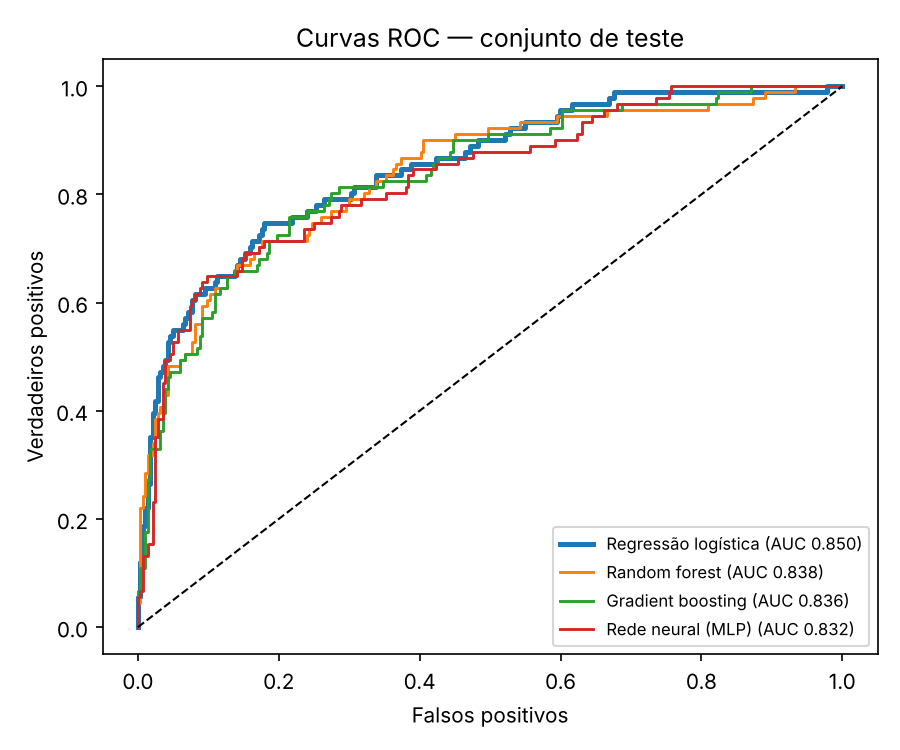
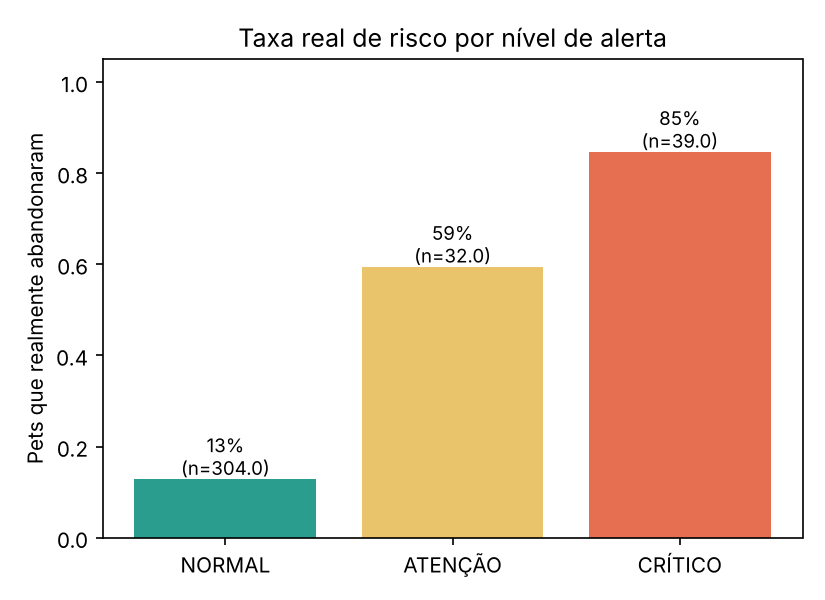
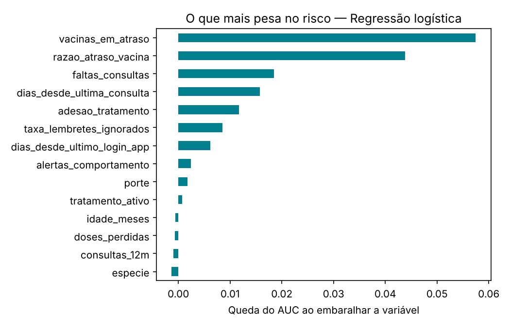

# Relatório de avaliação dos modelos — VetFlow

> **Atenção:** os dados são **sintéticos** (gerados em `vetflow_ai/data.py`). As métricas abaixo provam que a arquitetura funciona de ponta a ponta, **não** o desempenho que o modelo teria em clínicas reais.

- Pets no dataset: 1500 · prevalência de risco: 24.3% · teste: 375 pets (25%, estratificado)
- Preparação: {"linhas_entrada": 1500, "duplicados_removidos": 0, "valores_fora_da_faixa": {"idade_meses": 6, "dias_desde_ultima_vacina": 6}, "nulos_para_imputar": {"idade_meses": 6, "razao_atraso_vacina": 6, "dias_desde_ultima_consulta": 46, "taxa_lembretes_ignorados": 23, "dias_desde_ultimo_login_app": 22}, "linhas_saida": 1500, "problemas_qualidade": []}

## Comparação de modelos

| Modelo | AUC (CV 5-fold) | AUC teste | PR-AUC | Precisão | Recall | F1 | Brier |
|---|---|---|---|---|---|---|---|
| Regressão logística ✅ | 0.832 ± 0.016 | 0.850 | 0.703 | 0.793 | 0.505 | 0.617 | 0.117 |
| Random forest | 0.826 ± 0.025 | 0.838 | 0.689 | 0.714 | 0.495 | 0.584 | 0.124 |
| Gradient boosting | 0.808 ± 0.024 | 0.836 | 0.669 | 0.667 | 0.505 | 0.575 | 0.127 |
| Rede neural (MLP) | 0.822 ± 0.010 | 0.832 | 0.663 | 0.767 | 0.505 | 0.609 | 0.127 |

**Modelo escolhido:** Regressão logística — maior AUC em validação cruzada, além de ser o mais simples e interpretável.

## Níveis de alerta (limiares 0,40 / 0,70)

| Nível | Pets (teste) | Taxa real de risco |
|---|---|---|
| NORMAL | 304 | 12.8% |
| ATENÇÃO | 32 | 59.4% |
| CRÍTICO | 39 | 84.6% |

Com o corte padrão de 0,5 o modelo recupera 51% dos pets que de fato abandonaram; usando os cortes do sistema, alertar a partir de ATENÇÃO (≥ 0,40) recupera 57% e a partir de CRÍTICO (≥ 0,70) 36%. Por isso o fluxo de alertas trata ATENÇÃO como aviso preventivo e CRÍTICO como contato prioritário.

## O que mais pesa no risco (importância por permutação)

| Variável | Queda de AUC |
|---|---|
| vacinas_em_atraso | 0.0575 |
| razao_atraso_vacina | 0.0438 |
| faltas_consultas | 0.0185 |
| dias_desde_ultima_consulta | 0.0158 |
| adesao_tratamento | 0.0117 |
| taxa_lembretes_ignorados | 0.0085 |
| dias_desde_ultimo_login_app | 0.0062 |
| alertas_comportamento | 0.0024 |
| porte | 0.0017 |
| tratamento_ativo | 0.0007 |
| idade_meses | -0.0006 |
| doses_perdidas | -0.0007 |
| consultas_12m | -0.0010 |
| especie | -0.0013 |

## Limitações

- Rótulo simulado: em produção virá do histórico real (pet que não cumpriu vacina/retorno/dose em até 30 dias).
- O rótulo sintético é gerado por um processo latente quase **linear** (soma ponderada de sinais + ruído). Isso favorece a regressão logística; com dados reais, com interações mais complexas, random forest, boosting ou MLP podem superá-la. Por isso o pipeline compara os quatro e a escolha deve ser refeita quando houver dados reais.
- Os quatro modelos ficaram a menos de 0,03 de AUC entre si: a diferença entre eles não é conclusiva com este dataset.
- Nenhum dado de tutor real foi usado; antes de usar em clínica é preciso revalidar com dados reais e com veterinários.
- O score **apoia** a priorização; a decisão clínica continua sendo do veterinário.